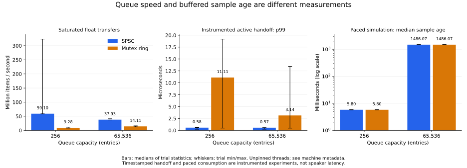

# Queue performance and buffering: preliminary cloud measurements

The SPSC implementation had higher measured transfer throughput than the bounded
mutex baseline. The current 65,536-sample buffer also produced about **1.486 seconds
of generated-to-callback sample age** in the paced simulation, for either queue.
These results support a queue performance comparison; physical playback latency
remains unmeasured.

## Main results

For the application's 65,536-entry capacity, medians across five trials were:

| Metric | SPSC | Preallocated mutex ring |
| --- | ---: | ---: |
| Saturated float transfer throughput | 37.93 million items/s | 14.11 million items/s |
| Throughput range across trials | 36.76–41.19 million items/s | 12.80–16.18 million items/s |
| Instrumented active handoff p50 | 0.415 µs | 0.911 µs |
| Instrumented active handoff p99 | 0.565 µs | 3.140 µs |
| Paced simulation sample age p50 | 1,486.073 ms | 1,486.072 ms |
| Paced simulation sample age p99 | 1,486.130 ms | 1,486.153 ms |
| Instrumented 256-frame callback p99 | 2.153 µs | 49.003 µs |

Quantile entries are medians of five per-trial quantiles, not pooled percentiles.
Full p50/p95/p99 ranges and observed maxima are in [SUMMARY.md](SUMMARY.md).
The ratio of median throughputs is approximately **2.69×** in this experiment.
It is a whole-implementation comparison, including different cursor bookkeeping
and memory layout. The two-thread transfer benchmark includes validation,
checksum work, retries, yields, and scheduling; its inverse throughput must not
be presented as an individual sample's latency.

The active-handoff experiment uses 16-byte timestamped messages, versus the
application's four-byte floats. At most one message is in flight; both threads
poll, and the acknowledgement happens after timing each message. It measures an
optimistic active exchange, with timestamp/acknowledgement overhead and scheduler
effects. The largest observed SPSC handoff at this capacity was 178.969 µs,
despite its much smaller median and p99. No maximum delay is guaranteed.

## Buffering dominates the simulated sample delay

At 44,100 samples/s, 65,536 samples represent 1.486077 seconds. The eager producer
keeps generating until the queue fills. The paced experiment confirms residence
near that capacity time once the two-second warmup has elapsed. The measured
age begins before the first enqueue attempt and ends when the simulated batch
has been consumed, so it also includes a possible full-queue retry wait and
within-batch handling time. Driver/device buffering would be additional.

With a 256-entry queue, both implementations had a median sample age of about
**5.802 ms** in the same 256-frame consumption schedule. That smaller capacity
is a benchmark configuration; the application's buffer has not been changed.
It makes the latency/underrun tradeoff visible rather than establishing that
256 entries is the correct production setting.

Each candidate/capacity had five measured intervals of 517 callbacks, each
scheduled for 3.001179 seconds after 345 warmup callbacks (2.002721 scheduled
seconds). Across the five trials per candidate/capacity:

- Both large-buffer candidates consumed all 661,760 scheduled measured samples.
- The small SPSC candidate consumed all 661,760 scheduled measured samples.
- The small mutex candidate had 256 empty reads in one callback in trial 4:
  256 of 661,760 scheduled samples were unavailable. Its p99 sample age in that
  trial was 7.913 ms and its largest observed age was 15.932 ms.
- None of the 2,585 measured callbacks per candidate/capacity exceeded the
  chosen 5.805 ms execution budget or completed after its next scheduled block.

An empty queue and a missed execution deadline are different outcomes. This run
does not identify the cause of the small mutex queue's underrun. It also does not
prove that the SPSC queue prevents underruns. Both implementations' measured
callback p99 values were well inside this particular period budget. No audible
benefit was tested. Timestamp and sequence-validation instrumentation is included
in callback timing; the real application's callback and sine producer were not
executed by this simulation.

## Reproducibility and limitations

- Host: shared Linux cloud instance, AMD EPYC 9V74 reported by the guest.
  Five logical CPUs were available to affinity, with a cgroup quota equivalent
  to four CPU cores. Threads were unpinned; no real-time priority was requested.
- Build: GCC 14.2.0, C++20, `-O3 -DNDEBUG`, no `-march=native`. Full compiler
  commands, binary/source SHA-256 hashes, kernel details, and quota are retained
  in [metadata.json](metadata.json).
- Measured host atomics: 64-bit atomics reported lock-free at compile time and
  runtime. `steady_clock` reported steady; back-to-back readings had median
  20 ns and p99 31 ns. No clock overhead was subtracted.
- Each microbenchmark trial transferred 5,000,000 floats or measured 20,000
  timestamped handoffs, following one retained warmup round. There were five
  measured trials for each capacity/candidate/mode. Candidate order alternated.
- Each paced trial used 44.1 kHz, a chosen 256-frame callback schedule, and a
  two-second warmup followed by three scheduled measurement seconds. Capacity
  and candidate order alternated. Scheduled durations are not wall-clock
  guarantees when callbacks wake late; wake lateness and late completions are
  retained separately.
- Workloads ran sequentially, after builds and correctness tests completed.
  Other tenants, CPU placement/migration, host load, and frequency changes were
  uncontrolled. At 256 entries, SPSC throughput ranged from 58.66 to 323.49
  million items/s; all trials are retained. The cause of that variation was not
  isolated, so neither the best trial nor a portable speedup claim is justified.
- Application source baseline: merged commit
  `2afcf827f5c35e8e1972b23630a7af1663c4e5c2`; benchmark additions were in the
  working tree when run. Source hashes identify the measured benchmark code.
- Measured interval: October 28, 2026, approximately 00:53–00:55 America/Phoenix;
  exact UTC process timestamps are in metadata. All 13 Release correctness tests
  passed before the final run, including both benchmark smoke checks.

The original application does not set a device period and has no external input
event: it generates a predetermined continuous sine wave. No audio hardware was
available here. These measurements do not establish output-device, round-trip,
control-to-sound, or acoustic latency, or hard real-time behavior.

## A defensible description

> Compared a custom SPSC ring with a capacity-matched, preallocated mutex ring.
> At 65,536 entries, median validated transfer throughput was 37.9 versus 14.1
> million float items/s across five trials on a shared Linux cloud instance.
> A separate 44.1 kHz paced simulation showed that the current eager-fill buffer
> creates about 1.486 seconds of sample lookahead. Hardware playback latency has
> not yet been measured.

For a credible low-playback-latency claim, the next experiment should run on the
intended computer/audio device. Configure and record actual device periods;
choose an explicit latency/underrun target; test several smaller buffer sizes
under representative load; and measure an identifiable marker through a physical
loopback with a documented timing reference. The [protocol](../../README.md)
explains how output-only and round-trip measurements differ.

## Evidence

- [Raw per-trial queue CSV, including warmups](queue.csv)
- [Raw per-trial paced simulation CSV](simulation.csv)
- [Queue diagnostics and timer metadata](queue.log)
- [Simulation progress/diagnostics](simulation.log)
- [Machine, build, source, command, and completion metadata](metadata.json)
- [Complete trial summary tables](SUMMARY.md) and [numeric summary CSV](summary.csv)
- [Shareable SVG figure](comparison.svg) and [PNG figure](comparison.png)

Re-run the commands in the [protocol](../../README.md), then use `summarize.py`
and optionally `plot_results.py`. Individual timestamp observations are not
retained; the raw CSV contains per-trial quantiles, counts, and durations.
